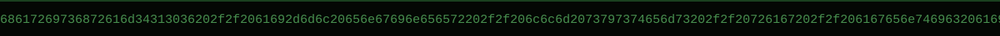

<p align="center">
  
</p>

<p align="center">
  
</p>

<p align="center">
  
</p>

<p align="center">
  
  
  <a href="https://harishram-webportfolio.vercel.app/"></a>
  
</p>

<br />

<p align="center">
  <a href="https://www.linkedin.com/in/harishram-balamurugan"></a>
  <a href="mailto:harishram.b06@gmail.com"></a>
  <a href="https://github.com/Harishram4106"></a>
</p>

<br />

<p align="center">
  
  
  
</p>

<p align="center"><code>🏆 SEBI TechSprint 2026 · ₹50,000 Jury Recommendation @ Global Fintech Fest</code></p>

---

## `> whoami`

Pre-final year **Computer Science** student at Chennai Institute of Technology who builds **AI systems end to end**: LLM apps, RAG pipelines, agentic workflows and the backends that keep them running. Two AI internships so far, most recently with the **GBS IT team at Flex**, where I shipped four production-style AI tools.

**Vantage** — my portfolio intelligence app — received a **₹50,000 Jury Recommendation** at **SEBI TechSprint 2026** (Global Fintech Fest). I'm also a certified **AWS AI Practitioner** with a perfect score of **1000 / 1000**.

Outside internships I build things I'd actually use: a durable workflow engine, a fully offline voice assistant, safety-first navigation, and image registration for ISRO's Chandrayaan-2 imagery.

```bash
$ cat .profile

ROLE        =  AI/ML Engineer  |  Full-Stack Developer
STUDY       =  B.E. CSE @ Chennai Institute of Technology (2024 – 2028)
EXP         =  AI Intern @ Flex (GBS IT)  |  AI Intern @ Skilleareum Inc
AWARD       =  SEBI TechSprint 2026 · ₹50K Jury Recommendation @ Global Fintech Fest
CERT        =  AWS Certified AI Practitioner · 1000 / 1000
FOCUS       =  LLM Apps  |  RAG  |  Agentic AI  |  MCP  |  Backend APIs
SIDE_BUILD  =  Perpetua  |  OutpaceHQ  |  Alfred  |  Jarvis  |  NaviHer  |  Lunaris
STACK       =  Python  |  FastAPI  |  Node.js  |  Next.js  |  Flutter  |  PostgreSQL
LOCATION    =  Chennai, India
OPEN_TO     =  AI Engineering  +  Backend  +  LLM Systems roles
```

---

## `> ls /tech-stack`

<p align="center"><b>[ Languages ]</b></p>
<p align="center">
  
</p>

<p align="center"><b>[ Frontend &amp; Mobile ]</b></p>
<p align="center">
  
</p>

<p align="center"><b>[ Backend &amp; Data ]</b></p>
<p align="center">
  
</p>

<p align="center"><b>[ Cloud, DevOps &amp; Tools ]</b></p>
<p align="center">
  
</p>

<p align="center"><b>[ AI &amp; LLM ]</b></p>
<p align="center">
  
  
  
  
  
  
  
  
  
  
  
  
</p>

---

## `> cat ai-expertise.json`

| Domain | Proficiency | Details |
| --- | --- | --- |
| **Retrieval &amp; RAG** | `█████` Strong | Hybrid BM25 + semantic search, reranking, FAISS, citation-backed answers |
| **LLM Apps &amp; Agents** | `█████` Strong | Claude, OpenAI and OpenRouter APIs, tool use, MCP, durable workflows |
| **AI Security** | `████▌` Solid | Prompt filtering, NER-based masking, risk classification before the model |
| **Document AI** | `████▌` Solid | OCR + LLM field parsing, layout-aware table extraction from invoices |
| **Backend &amp; APIs** | `████▌` Solid | FastAPI, Node.js, Express, PostgreSQL/PostGIS, MongoDB |
| **Local &amp; Mobile AI** | `████░` Growing | Offline voice with Whisper + Ollama, Flutter AI apps on Android |

---

## `> ls /projects --sort=impact`

<details open>
<summary><b>▶ Vantage — Portfolio Intelligence &nbsp;·&nbsp; 🏆 SEBI TechSprint 2026</b></summary>

<br />

Portfolio intelligence for Indian retail investors. Vantage X-rays your mutual fund holdings down to the underlying companies — so you see your real exposure, not just fund names. Received a **₹50,000 Jury Recommendation** at **SEBI TechSprint 2026**, Global Fintech Fest.

| Aspect | Detail |
| --- | --- |
| Stack | TypeScript |
| Award | 🏆 ₹50,000 Jury Recommendation · SEBI TechSprint 2026 @ Global Fintech Fest |
| Repo | [github.com/Harishram4106/Vantage](https://github.com/Harishram4106/Vantage) |

</details>

<details>
<summary><b>▶ Perpetua — Durable Workflow Engine</b></summary>

<br />

A Postgres-backed durable workflow engine. Every step is stored as an immutable event, so a crash mid-run never loses or repeats work: replay picks up exactly where it left off.

| Aspect | Detail |
| --- | --- |
| Stack | Python · PostgreSQL |
| Model | Event-sourced steps, deterministic replay |
| Why it matters | The reliability layer long-running AI agents need |
| Repo | [github.com/Harishram4106/Perpetua](https://github.com/Harishram4106/Perpetua) |

</details>

<details>
<summary><b>▶ OutpaceHQ — Event &amp; GTM Automation Backend</b></summary>

<br />

An event-management and go-to-market automation backend. It mirrors events to Luma through browser automation, answers attendee questions over WhatsApp and email with a RAG concierge, and generates multi-channel marketing.

| Aspect | Detail |
| --- | --- |
| Stack | Python · FAISS · Claude · browser automation |
| AI | FAISS + Claude RAG concierge over WhatsApp and email |
| Repo | [github.com/Harishram4106/OutpaceHQ](https://github.com/Harishram4106/OutpaceHQ) |

</details>

<details>
<summary><b>▶ InsightRAG — AI Document Q&amp;A</b></summary>

<br />

Ask questions of your PDFs, DOCX and TXT files and get answers that cite their sources.

| Aspect | Detail |
| --- | --- |
| Stack | Python · Claude · React · TypeScript |
| Retrieval | Hybrid BM25 + semantic search with a reranking stage |
| Output | Grounded, citation-backed answers |
| Repo | [github.com/Harishram4106/InsightRAG](https://github.com/Harishram4106/InsightRAG) |

</details>

<details>
<summary><b>▶ PromptShield — AI Security Gateway for LLMs</b></summary>

<br />

FastAPI middleware that sits in front of an LLM and decides whether each prompt is blocked, masked or allowed.

| Aspect | Detail |
| --- | --- |
| Stack | Python · FastAPI · NER |
| Pipeline | Regex rules → named-entity detection → risk classification |
| Decisions | BLOCK · MASK · ALLOW |
| Repo | [github.com/Harishram4106/PromptShield-AI-Security-Gateway-for-LLM](https://github.com/Harishram4106/PromptShield-AI-Security-Gateway-for-LLM) |

</details>

<details>
<summary><b>▶ Alfred — Fully Local Voice Assistant for macOS</b></summary>

<br />

Press Ctrl+Alt+A and speak. Alfred opens apps, controls Spotify, sends WhatsApp messages, adds calendar events, takes notes, sets timers, translates, reads your screen and remembers what you told it.

| Aspect | Detail |
| --- | --- |
| Stack | Python · Whisper · Ollama |
| Privacy | Runs entirely on-device: no cloud, no accounts |
| Repo | [github.com/Harishram4106/Alfred](https://github.com/Harishram4106/Alfred) |

</details>

<details>
<summary><b>▶ Jarvis — Free AI Assistant for Android</b></summary>

<br />

Chats with zero-cost OpenRouter models, searches the web, sets timers and alarms, opens apps, manages your calendar and drafts text.

| Aspect | Detail |
| --- | --- |
| Stack | Flutter · Dart · OpenRouter |
| Repo | [github.com/Harishram4106/Jarvis](https://github.com/Harishram4106/Jarvis) |

</details>

<details>
<summary><b>▶ NaviHer — Safety-First Navigation</b></summary>

<br />

Routes by lighting, foot traffic and proximity to safe havens, not just speed. Compare the safest and fastest routes, and reroute to a safe place in one tap.

| Aspect | Detail |
| --- | --- |
| Stack | Flutter · Dart · PostGIS |
| Repo | [github.com/Harishram4106/NaviHer](https://github.com/Harishram4106/NaviHer) |

</details>

<details>
<summary><b>▶ Lunaris — Chandrayaan-2 Image Registration</b></summary>

<br />

Automatically aligns optical images from Chandrayaan-2's OHRC, TMC and IIRS instruments with reference lunar imagery, despite differences in sun angle and viewing geometry.

| Aspect | Detail |
| --- | --- |
| Domain | Computer vision · space imagery |
| Repo | [github.com/Harishram4106/Lunaris](https://github.com/Harishram4106/Lunaris) |

</details>

<details>
<summary><b>▶ Invoice Data Extractor</b></summary>

<br />

Extracts structured data from invoice PDFs and images. This builds on the invoice extractor from my Flex internship.

| Aspect | Detail |
| --- | --- |
| Stack | FastAPI · React · PaddleOCR · Claude · PyMuPDF · Camelot |
| Pipeline | OCR → LLM field parsing → layout-aware table extraction |
| Repo | [github.com/Harishram4106/Invoice-Data-Extractor](https://github.com/Harishram4106/Invoice-Data-Extractor) |

</details>

<details>
<summary><b>▶ More builds</b></summary>

<br />

| Project | What it does | Stack |
| --- | --- | --- |

| [Dusk](https://github.com/Harishram4106/Dusk) | Pre-shift readiness screening: reaction time, webcam hand-tremor (FFT) and speech prosody | JavaScript |
| [Cadence](https://github.com/Harishram4106/Cadence) | Social habit tracker with GPS or step-verified check-ins | Flutter |
| [Taskly](https://github.com/Harishram4106/Taskly) | Tasks, habits, focus timer and stats in one Android app | Flutter |
| [AuthentiQ](https://github.com/Harishram4106/AuthentiQ) | AI document verification with blockchain-anchored integrity | Next.js · TypeScript |
| [DHRW](https://github.com/Harishram4106/DHRW) | Decentralized health records with AI report analysis on Shardeum | Node.js · Web3 |
| [Herizon](https://github.com/Harishram4106/Herizon) | Women's travel safety app: SOS, check-ins, live location | Next.js · Firebase |
| [ArthAI](https://github.com/Harishram4106/ArthAI) | AI wealth advisory and financial planning platform | React · Node.js |

[→ all 26 repositories](https://github.com/Harishram4106?tab=repositories)

</details>

---

## `> cat experience.log`

**`[2026-04 → 2026-05]`  AI Intern — Flex (GBS IT Team)** · On-site

Built four AI tools for real business use cases with the GBS IT team.

- **Automated Email Responder**: analyzes incoming mail and drafts context-aware replies
- **Prompt Security Filter**: stops unsafe, malicious or policy-violating prompts before they reach an LLM
- **LLM Classifier with RAG**: retrieval-augmented classification for better accuracy and context
- **Invoice Data Extractor**: pulls structured information out of invoice documents

`Python` `LLMs` `RAG` `Prompt Engineering` `AI Security` `Intelligent Automation`

<br />

**`[2025-11 → 2025-12]`  AI Intern — Skilleareum Inc** · Remote

Agentic AI and gamification for an AI-driven, decentralized learning platform.

- Designed adaptive learning flows that personalize content to each learner's progress
- Built AI-assisted quiz and feedback generation
- Implemented gamification: XP, badges and progression tracking

`Agentic AI` `LLMs` `Gamification` `EdTech`

---

## `> echo $ACHIEVEMENTS`

| Win | Detail |
| --- | --- |
| **▮ SEBI TechSprint 2026** | Vantage: ₹50,000 Jury Recommendation at Global Fintech Fest |
| **▮ AWS Certified AI Practitioner** | Perfect score — 1000 / 1000 |
| **▮ RevengersHack** | 8th on the leaderboard (top 15) with team White Hats |
| **▮ Browser-Use Hackathon** | Bengaluru |
| **▮ Hackathon Finalist** | DEFY'26 at VIT Chennai: reached the final round out of 50 teams in a 24-hour build |
| **▮ 2x AI Intern** | Flex (GBS IT) and Skilleareum Inc, before final year |
| **▮ Space Tech** | Lunaris: image registration for ISRO's Chandrayaan-2 imagery |
| **▮ Builder** | 26 public repos across AI systems, mobile apps, Web3 and full-stack |
| **▮ Certified** | 73+ certifications incl. AWS AI Practitioner (1000/1000), Anthropic, MongoDB and NPTEL (IIT Roorkee) |
| **▮ Hackathons** | NXTGEN (SRMIST) · HackXios 2k25 (IIIT Bhopal x Devfolio) · RevengersHack · Browser-Use Hackathon (Bengaluru) |

---

## `> git log --oneline /education`

<p align="center">
  
</p>
<p align="center">
  
</p>

<!--
## `> cat coding-profiles.sh`

<p align="center">
  <a href="https://leetcode.com/YOUR_HANDLE"></a>
  <a href="https://www.geeksforgeeks.org/user/YOUR_HANDLE"></a>
  <a href="https://www.hackerrank.com/profile/YOUR_HANDLE"></a>
  <a href="https://www.codechef.com/users/YOUR_HANDLE"></a>
</p>

---
-->

---

## `> git stats --global`

<p align="center">
  
  
</p>
<p align="center">
  
</p>


## `> activity-graph --timeline`

<p align="center">
  
</p>

---

## `> contribution-report --detailed`

<p align="center">
  
  
</p>
<p align="center">
  
  
</p>

---

## `> ./snake-animation.sh`

<p align="center">
  <picture>
    <source media="(prefers-color-scheme: dark)" srcset="https://raw.githubusercontent.com/Harishram4106/Harishram4106/output/github-snake-dark.svg" />
    <source media="(prefers-color-scheme: light)" srcset="https://raw.githubusercontent.com/Harishram4106/Harishram4106/output/github-snake.svg" />
    
  </picture>
</p>

---

## `> cat current-focus.yaml`

```yaml
learning:
  - Agentic AI architectures & MCP workflows
  - Durable execution for long-running agents

building:
  - Perpetua   # durable workflow engine
  - Jarvis     # free AI assistant for Android
  - Cadence    # social habit tracker

exploring:
  - Local-first AI with Whisper + Ollama
  - Retrieval quality: hybrid search, reranking, citations

open_to:
  - AI Engineering roles
  - Backend & LLM Systems roles
```

---

## `> ping me`

<p align="center">
  <a href="mailto:harishram.b06@gmail.com"></a>
  <a href="https://www.linkedin.com/in/harishram-balamurugan"></a>
  <a href="https://github.com/Harishram4106"></a>
  <a href="https://harishram-webportfolio.vercel.app/"></a>
</p>

<p align="center"><code>// by day: CS student  |  by night: shipping AI systems</code></p>


